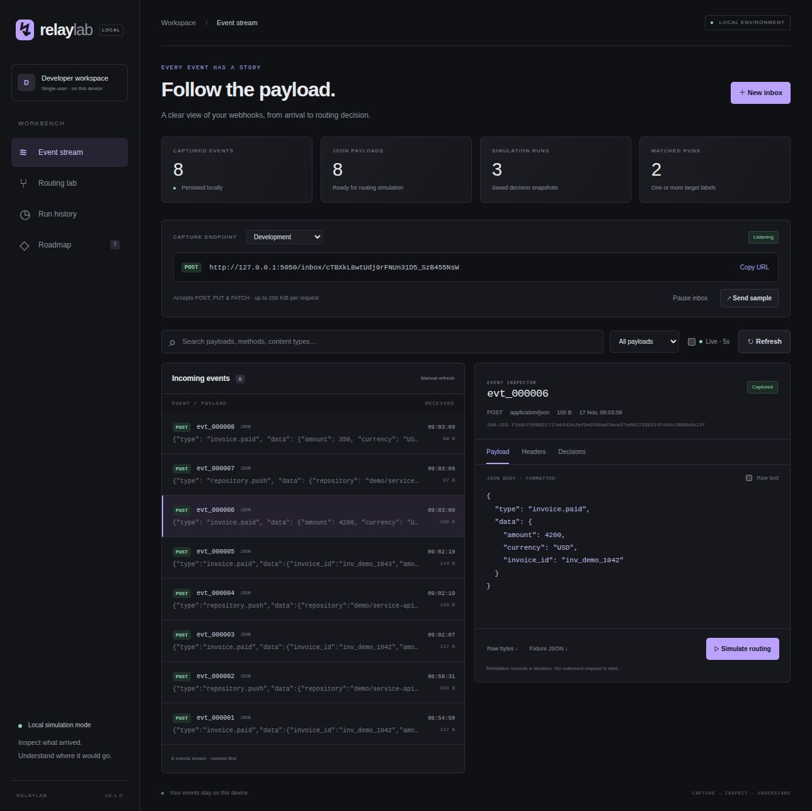

# RelayLab

**Capture the event. Inspect the payload. Explain the decision.**

A local webhook workbench built with **Python, Flask, JavaScript, and SQLite**. Receive real HTTP requests, inspect exact payloads, simulate routing rules, and retain the reasoning behind each run.

**This release implements 5 of 12 features. The other 7 are substantial, explicitly unfinished engineering projects.** The working core needs no message broker, cloud account, paid API, or optional roadmap service.



## What is different about this project?

RelayLab is an event-processing developer tool. Its core includes byte-preserving ingestion, concurrent database writes, cursor pagination, a typed rule interpreter, and persisted decision snapshots. The remaining work extends into distributed systems, security, isolation, data contracts, and operations.

The core is deliberately usable before the delivery infrastructure exists: point a local integration at an inbox, inspect what arrived, and test which target labels your rules select. **Simulation does not deliver requests.**

## The 12-feature scope

| # | Feature | Status | Current behavior or remaining scope |
|---|---|---|---|
| 1 | Durable capture inboxes | ✅ Implemented | Create named endpoints; pause/resume; capture POST/PUT/PATCH body bytes, metadata, timestamps, and SHA-256 before returning HTTP 202. |
| 2 | Event inspection workbench | ✅ Implemented | Search payloads/methods/content types, filter JSON vs other bodies, page older events, inspect headers/raw text/formatted JSON, and poll every 5 seconds. |
| 3 | Declarative routing simulator | ✅ Implemented | Create/edit/disable global rules using JSON Pointer, typed operators, and ALL/ANY matching; show condition-level results. |
| 4 | Decision audit history | ✅ Implemented | Persist simulation snapshots with rule revisions, condition results, selected target labels, engine version, and the event hash. |
| 5 | Fixture export and sample traffic | ✅ Implemented | Export byte-exact bodies or versioned JSON fixtures; generate real sample requests from the UI or Python script. |
| 6 | Durable outbound delivery workers | 📝 Planned | Transactional outbox, worker leases, attempt records, crash recovery, and safe HTTP egress. |
| 7 | Retry, ordering, and replay engine | 📝 Planned | Backoff/jitter, dead-letter queues, idempotency, per-target ordering, and controlled replay. |
| 8 | Signature verification and replay protection | 📝 Planned | Verify raw-byte signatures, enforce timestamp windows, rotate secrets, and reject repeated signed requests. |
| 9 | Sandboxed payload transformations | 📝 Planned | Versioned transform programs, isolated workers, resource limits, deterministic execution, and rollback. |
| 10 | Schema registry and compatibility checks | 📝 Planned | Versioned JSON Schemas, compatibility policy, bounded validation, and quarantined payloads. |
| 11 | Multi-tenant projects and access control | 📝 Planned | Authentication, project ownership, scoped roles/tokens, tenant quotas, and isolation tests. |
| 12 | Operational observability and retention | 📝 Planned | Trace propagation, queue metrics, backpressure, retention policies, and workload-driven performance tests. |

**Seven features remain, versus three in Trailmark. Feature counts do not imply equal effort:** the remaining distributed delivery and security work is considerably larger than the local core. Each planned feature has concrete contracts, dependencies, failure cases, and acceptance tests in [ROADMAP.md](ROADMAP.md).

## Quick start

Requirements: **Python 3.11+** and a modern browser. Node.js 18+ is only needed for JavaScript development checks. No frontend build or `npm install` is required.

Clone the repository and enter the project folder:

```bash
git clone https://github.com/mukesh-mehta/relaylab.git
cd relaylab
```

If you already have the project, open a terminal inside its `relaylab` folder instead.

### Linux / macOS

```bash
python3 -m venv .venv
source .venv/bin/activate
python -m pip install -r requirements.txt
python -m flask --app relaylab seed
python -m relaylab
```

### Windows PowerShell

```powershell
py -3 -m venv .venv
.\.venv\Scripts\python.exe -m pip install -r requirements.txt
.\.venv\Scripts\python.exe -m flask --app relaylab seed
.\.venv\Scripts\python.exe -m relaylab
```

Open **http://127.0.0.1:5050**. Keep the terminal open; stop with **Ctrl+C**.

The `seed` command is optional. It creates a **Development** inbox and two sample rules, without fabricating events or overwriting existing entries. Running it twice is safe. Without it, start with **New inbox** and create a rule in **Routing lab**.

## Try the complete workflow

1. Click **Send sample**. A real HTTP request arrives through the selected capture endpoint and appears in the event stream.
2. Inspect **Payload** and **Headers**. Compare formatted JSON with the raw text preview.
3. Click **Simulate routing**. With the seeded rules, the first sample selects `finance-review` because its type is `invoice.paid` and its amount is greater than 2000.
4. Send another sample. It represents a main-branch repository push and selects `deployment-pipeline`.
5. The third sample is a smaller invoice. It matches neither seeded rule. A no-match result is still saved as a run.
6. Edit a rule in **Routing lab** and simulate again. Open **Run history** to compare snapshots: past runs keep the original conditions, target label, and revision.
7. Download **Fixture JSON** for test data, or **Raw bytes** for an exact body copy.

**Sample payloads are synthetic.** No Stripe, GitHub, or other external account integration is implied. Target labels are names, not network destinations.

### Send from your own app

Copy the endpoint shown in the UI and replace `YOUR_INBOX_TOKEN`:

```bash
curl -i -X POST http://127.0.0.1:5050/inbox/YOUR_INBOX_TOKEN \
  -H 'Content-Type: application/json' \
  --data-binary '{"type":"invoice.paid","data":{"amount":4200,"currency":"USD"}}'
```

Or, with the app running and an inbox available:

```bash
python examples/send_demo.py
```

The script sends three requests to the first inbox. A paused inbox returns **410**; the script reports the error. This app listens on loopback, so hosted providers cannot reach it directly. Public ingress and secure hosting are not part of v0.1.

## Rule language

A rule contains a name, a target label, `mode` (`all` or `any`), an enabled flag, and **1–8 conditions**:

```json
{
  "name": "High-value invoices",
  "target": "finance-review",
  "mode": "all",
  "enabled": true,
  "conditions": [
    {"path": "/type", "op": "equals", "value": "invoice.paid"},
    {"path": "/data/amount", "op": "greater_than", "value": 2000}
  ]
}
```

| Operator | Meaning |
|---|---|
| `equals` | Typed scalar comparison. `1` equals `1.0`; `true` does not equal `1`; `"1"` does not equal `1`. |
| `contains` | Case-sensitive substring match on a string. Arrays are not searched. |
| `exists` | A boolean expected value tests presence. A present `null` is different from a missing path. |
| `greater_than` | Strict numeric comparison, without string or boolean coercion. |

Paths use [JSON Pointer](https://www.rfc-editor.org/info/rfc6901/): `/items/0/id` accesses an array item; `/a~1b` accesses the key `a/b`; `/a~0b` accesses `a~b`; the empty path selects the document root. Missing paths fail comparisons except `exists: false`.

Rules apply to **every inbox**, in ascending rule ID order. All enabled rules are evaluated; this is not a first-match router. Matched target labels are deduplicated while preserving order. Values are JSON scalars, not code, regexes, templates, or scripts.

## Storage and guarantees

- SQLite lives at `instance/relaylab.sqlite3`; the database and its WAL/SHM files are ignored by Git.
- An accepted capture is committed before the HTTP 202 response. If the sender loses the response and retries, **a second event is captured**; ingress deduplication is not implemented.
- Body bytes are retained exactly, including whitespace and binary data. A SHA-256 digest describes those bytes. The UTF-8 raw preview replaces undecodable bytes; use the binary download or base64 fixture for byte-exact data.
- JSON classification is based on body content, not just `Content-Type`. Non-finite numbers, duplicate object keys, invalid UTF-8, and excessive parser nesting are treated as non-JSON. Such bodies are still captured within the request size limit, but cannot be simulated.
- Formatted JSON is produced by Python and returned as text, so large integer values do not get rounded by JavaScript parsing.
- Common credential headers are redacted before storage: `Authorization`, `Proxy-Authorization`, `Cookie`, `Set-Cookie`, `X-Api-Key`, and `X-Auth-Token`. **Bodies, query strings, and other headers are not automatically redacted.** Use synthetic or appropriately sanitized data.
- Headers are the application-level representation exposed by Flask; duplicate header lines, original casing, and transport framing are not preserved byte-for-byte.
- Each run snapshots enabled rule revisions and decisions in one transaction. Later rule changes do not rewrite the snapshot. This is application-level history, **not a tamper-proof compliance log**.
- Fixture JSON contains one event, a version number, redacted headers, metadata, and `body_base64`. It is for portable test data; fixture import and request replay are not implemented.
- All writes are local. The Python app performs no outbound delivery, DNS lookup, or URL fetching.

To use a separate database:

```bash
RELAYLAB_DATABASE=/absolute/path/lab.sqlite3 python -m relaylab
```

Set the same variable when seeding. For an exact backup, stop the server and copy the SQLite database **and any accompanying `-wal`/`-shm` files as a set** to a safe location. A live backup needs SQLite's backup API; copying an active database file alone is not supported.

## Architecture and source layout

```text
HTTP sender ──> /inbox/<token> ──> SQLite events (raw bytes + metadata)
                                        │
Browser inspector <── Flask API <────────┘
        │
        └── simulate ──> deterministic rule engine ──> run snapshot

No outbound delivery worker exists in v0.1.
```

```text
relaylab/
├── relaylab/
│   ├── app.py              # HTTP capture and management API
│   ├── db.py               # Schema, SQLite connections, timestamps
│   ├── engine.py           # JSON Pointer resolution and rule interpreter
│   ├── samples.py          # Optional seed rules
│   ├── __main__.py         # Loopback server on port 5050
│   ├── templates/index.html
│   └── static/             # JavaScript modules, CSS, icon
├── tests/                  # API, concurrency, rule semantics, JS helper tests
├── examples/send_demo.py   # Real HTTP sample sender
├── docs/                   # Architecture, API, research, verification, screenshot
├── .github/workflows/      # CI matrix
└── ROADMAP.md              # Seven unfinished engineering workstreams
```

Read [ARCHITECTURE.md](docs/ARCHITECTURE.md) for invariants and extension points, and [API.md](docs/API.md) for endpoint contracts.

## Development and tests

With the Python environment active:

```bash
python -m pip install -r requirements-dev.txt
python -m pytest -q
npm run check
npm test
```

Tests use temporary databases. The suite checks raw bytes, fixtures, restart persistence, concurrent captures, stable pagination, pause/resume, strict validation, typed matching, escaped pointers, and snapshot preservation. CI is configured for Python 3.11–3.13 and Node 22. Local verification details and limitations are in [VERIFICATION.md](docs/VERIFICATION.md).

## Limits of this release

- **Local, single-user development only.** There is no authentication or tenant isolation. An inbox token is a routing identifier, not a substitute for access control. Host validation and management-request headers are browser safeguards, not login.
- The server binds to `127.0.0.1`, accepts localhost hosts, and uses Flask's development server. Do not expose it publicly without implementing the relevant security and deployment work.
- Request bodies are limited to **256 KiB**. SQLite serializes writers; searches scan stored bodies; storage and rule counts have no automatic retention policy. No throughput/SLA claim is made.
- The stream polls every **5 seconds** while its tab is visible and the capture view is open. Loading older events switches to manual refresh. This is not WebSocket or SSE streaming.
- Metrics describe the whole local database, not the current inbox/filter. Inbox selection and search state are not persisted across reloads.
- Event/inbox deletion, fixture import, full historical rule-version browsing, and automatic simulation on receipt are not included.
- Roadmap features are described in documentation and the read-only Roadmap view. They are not exposed as working delivery controls.

## Troubleshooting

- **Port 5050 busy:** `python -m flask --app relaylab run --host 127.0.0.1 --port 5051`, then open `http://127.0.0.1:5051`.
- **No events:** use the exact displayed inbox URL; confirm it is listening; clear search/format filters; enable Live or press Refresh.
- **Simulation disabled:** the captured body did not pass the strict JSON parser. Check raw bytes, encoding, duplicate keys, and numeric values.
- **No matching targets:** inspect each condition result; check JSON types, pointer paths, enabled rules, and ALL vs ANY mode.
- **Module not found:** activate `.venv` and reinstall `requirements.txt` from the project directory.
- **Missing `venv` on Ubuntu/Debian:** install the distribution's `python3-venv` package.
- **Database newer than this app:** startup refuses unknown schema versions. Restore a compatible backup or use the matching app version.

## Repository workflow and contributing

The repository is [mukesh-mehta/relaylab](https://github.com/mukesh-mehta/relaylab). Start a focused branch from the latest `main` for each change:

```bash
git switch main
git pull --ff-only
git switch -c feat/your-feature
```

Make the change and run the checks in **Development and tests**. Then stage the relevant files and review the diff before committing:

```bash
git add path/to/changed-file
git diff --cached --stat
git diff --cached
git commit -m "feat: describe the change"
git push -u origin feat/your-feature
```

Replace the example branch name and file path with your own. Open a pull request to `main` and wait for [GitHub Actions](https://github.com/mukesh-mehta/relaylab/actions) to pass before merging. Use `fix:`, `test:`, or `docs:` when those better describe the change.

Review staged files for databases, fixture exports, credentials, and virtual environments. Default exported fixture filenames are ignored; keep exports with custom names outside the repository. GitHub hosts the source; GitHub Pages cannot run this Python backend.

Start with [CONTRIBUTING.md](CONTRIBUTING.md). The most useful next implementation is **feature 6**, followed by feature 7; security and tenant isolation are required before any hosted deployment.

## Research and license

[Hookdeck's event model](https://hookdeck.com/docs/hookdeck-basics) and [Svix's webhook delivery architecture](https://www.svix.com/webhook-architecture/) informed the distinction between receipt, routing, and delivery. This is an original implementation, not a fork or an equivalent production service. See [RESEARCH.md](docs/RESEARCH.md) for the selection rationale. MIT licensed; see [LICENSE](LICENSE).
